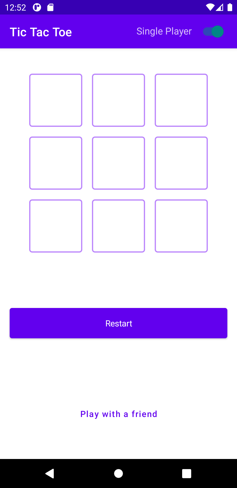
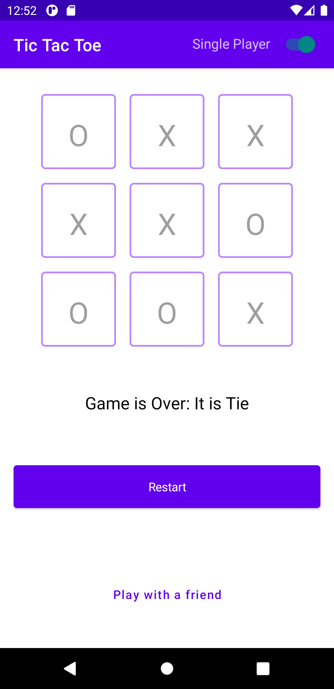
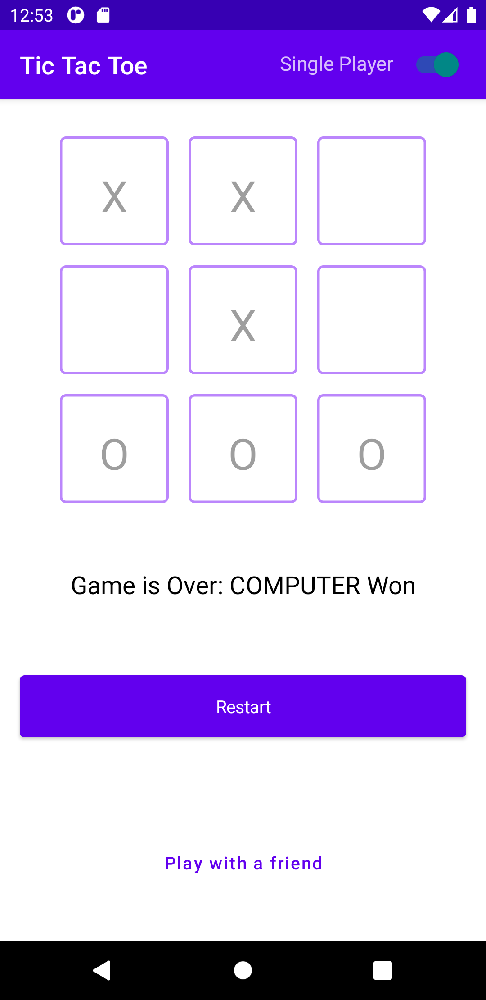
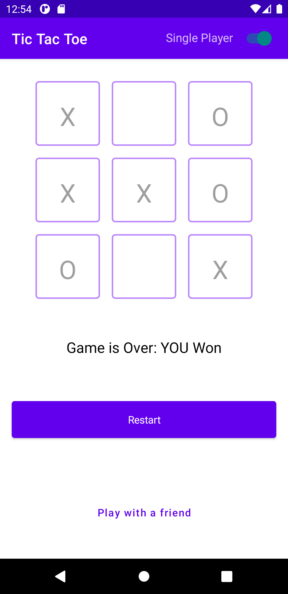

# Tic Tac Toe

Tic Tac Toe implementation - Single and Double player(s) with Kotlin and JetpackCompose.

## Libraries
* 100% Kotlin
* Jetpack
	* Compose - an Android Tooolkit for building native UI - less code, intuitive, accelerated develpmemt and powerful
	* ViewModel - store and manage UI-related data in a lifecycle conscious way.

* Kotlin DSL buildSrc plugin

## Architecture
MVVM - Model Veiw ViewModel - Unidirectional data flow using MVVM and `mutableStateof()` from JetpackCompose.

## Preview

## Requirements
AndroidStudio >= 4.2 

created new srujan branch 2 from main   

hi this is new branch from the main branch